# Діаграми системи

Діаграми описують архітектуру, предметну область і правила роботи системи. Бізнес-підписи українською; технічні ідентифікатори збігаються з кодом. Логічна модель пояснює предметну область без Java-типів і службових зовнішніх ключів. Технічні деталі залишені в архітектурі та діаграмах послідовності.

| Діаграма | Рівень | Що пояснює | Відповідний код |
| --- | --- | --- | --- |
| [Архітектура](svg/architecture.svg) | Технічний | Браузер, один контейнер, Spring Security, сервіси, H2 та папка даних | `SecurityConfig`, `docker/compose.yaml` |
| [Модель предметної області](svg/domain.svg) | Логічний | Ролі, користувачі, готелі, номери, бронювання, проживання й дохід; кратності зв’язків | `data/entity`, V1 |
| [Початкове налаштування](svg/setup-flow.svg) | Процес | Синхронізація ролей, захист повторного setup, створення мережі й номерів | `HotelsApplication`, `AuthService`, `UserService` |
| [Вхід і доступ](svg/authentication-sequence.svg) | Технічний | JWT → HotelToken, поточна роль із БД, 401 і 403 | `JwtService`, `HotelTokenConverter`, `HotelToken` |
| [Пошук і бронювання](svg/booking-sequence.svg) | Технічний | Точні / більші номери, повторна перевірка перетинів під блокуванням, commit / rollback | `BookingService`, `RoomRepository` |
| [Стани бронювання](svg/booking-lifecycle.svg) | Логічний | Створення, зміна дат, скасування, заселення та завершення | `BookingService`, `StayService` |
| [Стани номера](svg/room-lifecycle.svg) | Логічний | FREE → OCCUPIED → CLEANING → FREE, окремо від бронювань | `StayService` |
| [Заселення](svg/checkin-flow.svg) | Процес | З бронюванням або без нього, власний готель, готовність номера, фіксація ціни | `StayService.checkIn` |
| [Виселення й клінінг](svg/checkout-flow.svg) | Процес | Межа 12:00, мінімум одна ніч, атомарний запис доходу, завершення клінінгу | `StayService`, `StayCalculator` |
| [Календар](svg/calendar-flow.svg) | Процес | Поєднання станів і видима накладка, межі показу клінінгу й відкритого проживання | `CalendarService`, `CalendarDayFactory` |
| [Звіт про дохід](svg/revenue-flow.svg) | Процес | Рольовий доступ, фільтр готелю й періоду, підсумок за фактичним виселенням | `RevenueService` |

## Діаграми

### Архітектура

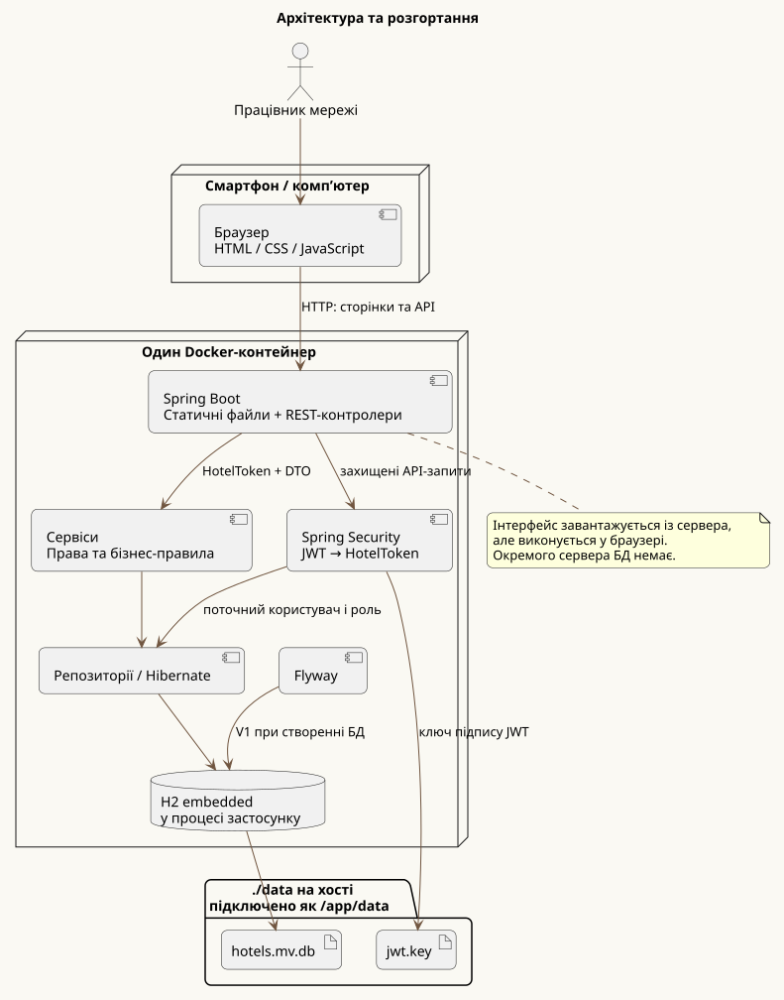

[PlantUML](architecture.puml)

### Модель предметної області

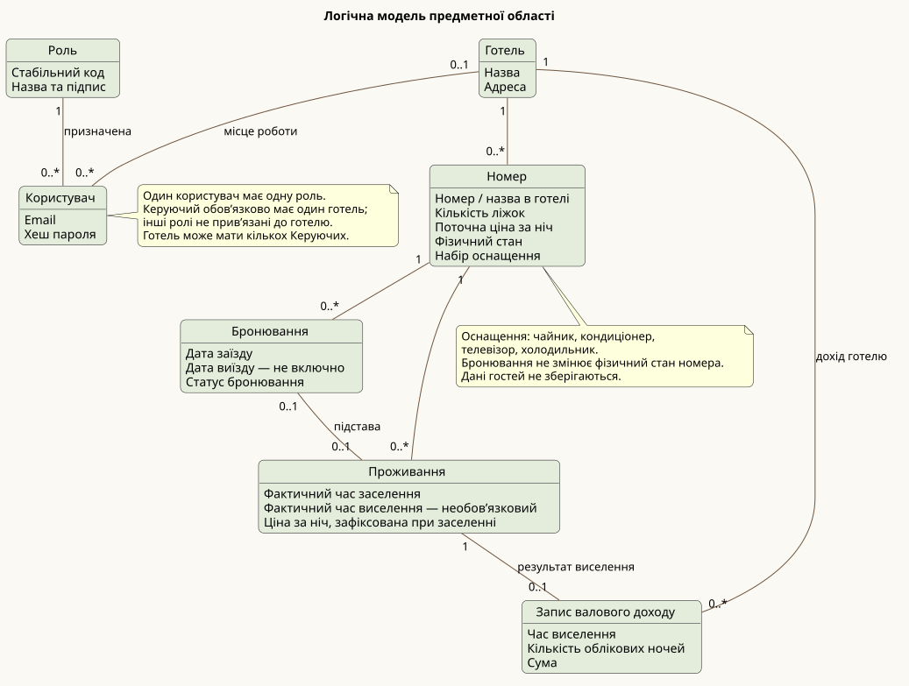

[PlantUML](domain.puml)

### Початкове налаштування

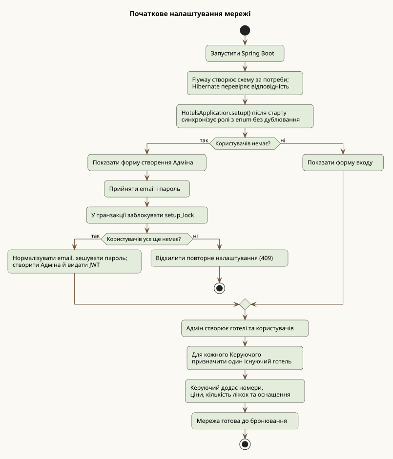

[PlantUML](setup-flow.puml)

### Вхід і доступ

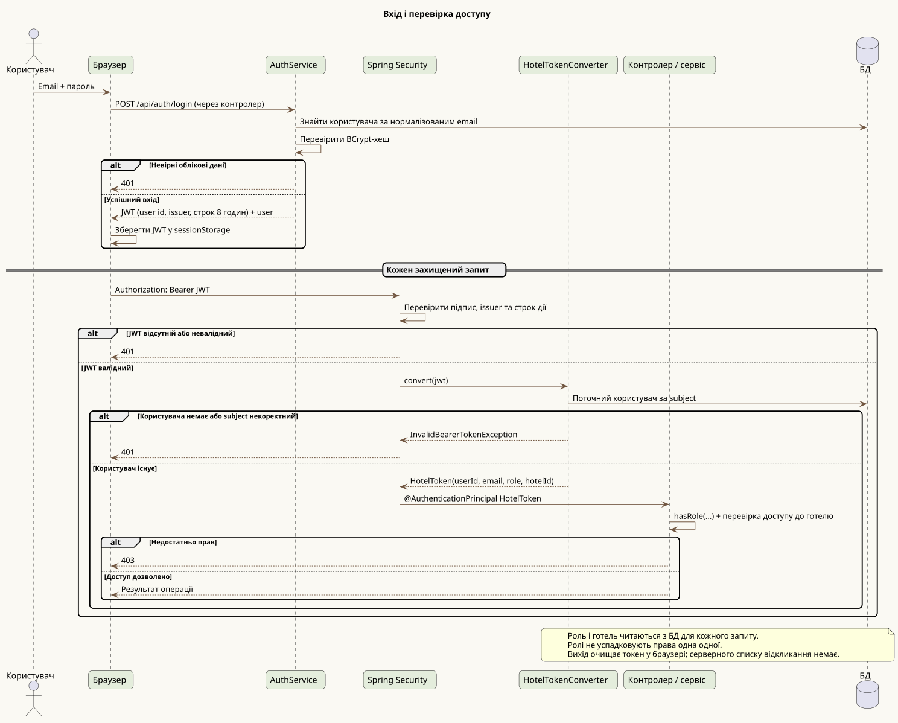

[PlantUML](authentication-sequence.puml)

### Пошук і бронювання

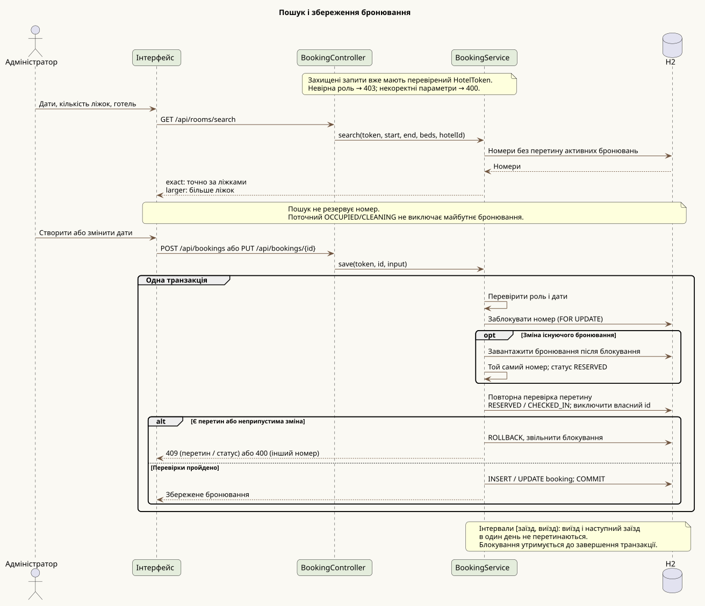

[PlantUML](booking-sequence.puml)

### Стани бронювання

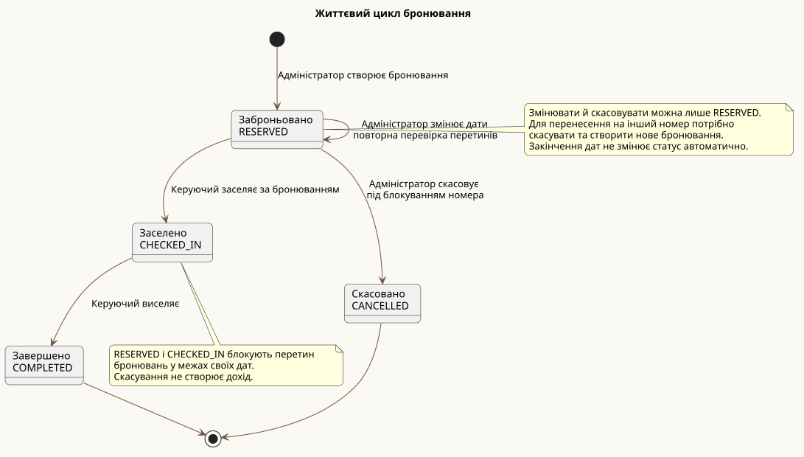

[PlantUML](booking-lifecycle.puml)

### Стани номера

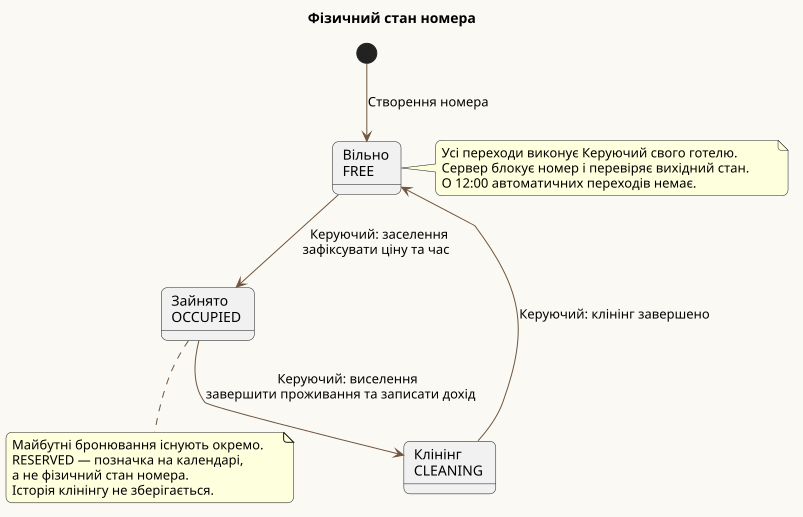

[PlantUML](room-lifecycle.puml)

### Заселення

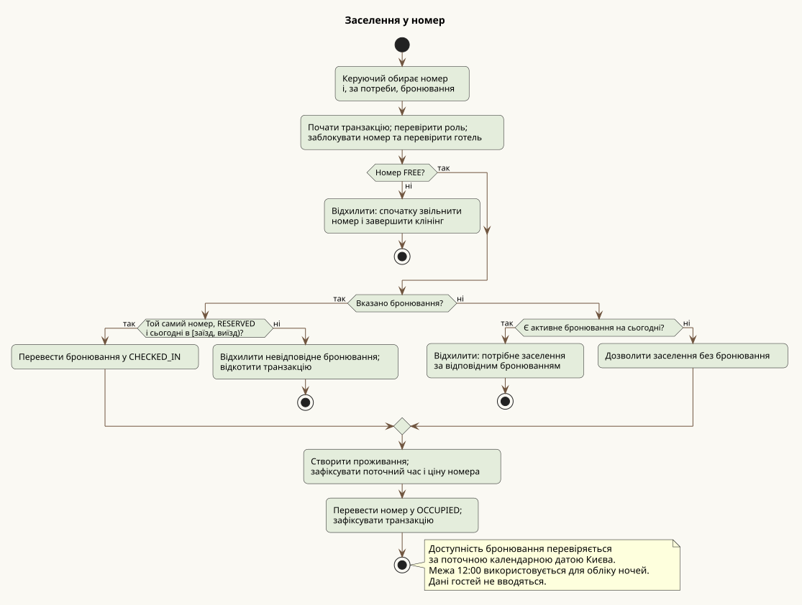

[PlantUML](checkin-flow.puml)

### Виселення й клінінг

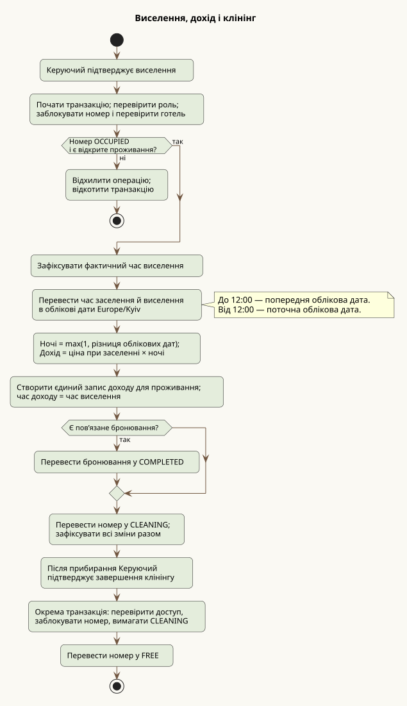

[PlantUML](checkout-flow.puml)

### Календар

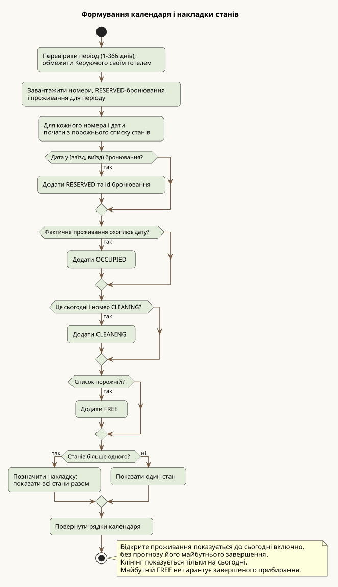

[PlantUML](calendar-flow.puml)

### Звіт про дохід

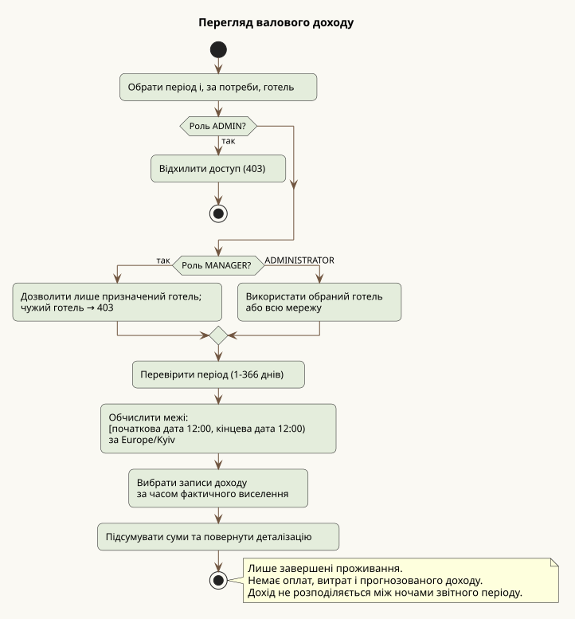

[PlantUML](revenue-flow.puml)

## Покриття важливих сценаріїв

Описано весь основний ланцюжок: початкове налаштування → користувачі й готелі → номери → пошук → бронювання → заселення → виселення й дохід → клінінг. Окремо показано зміну дат і скасування, авторизацію, календарні накладки та звітність.

Прості операції редагування назви готелю, оснащення й ціни номера не мають окремих діаграм послідовності: вони представлені в початковому налаштуванні та логічній моделі. Перевірки полів і відповіді 404 не розписані в кожній гілці; джерелом точних HTTP-контрактів залишаються контролери й сервіси.

## Правила відображення та обліку

- Система веде облік номерів, бронювань, проживань і валового доходу. Персональні дані гостей, платежі та витрати не належать до її предметної області.
- Керуючий підтверджує заселення, виселення та завершення клінінгу вручну. Межа 12:00 визначає облікову добу.
- Календар поєднує майбутні бронювання з фактичним проживанням до поточної дати включно. Клінінг позначає готовність номера на сьогодні.
- Можливість заселення за бронюванням перевіряється за календарною датою Києва; кількість ночей розраховується за обліковими датами з межею 12:00.
- Сесія використовує JWT зі строком дії 8 годин. Вихід очищає токен у браузері; виданий токен залишається чинним до завершення строку дії. Права користувача перевіряються за даними БД у кожному запиті.

## Перегляд і експорт

SVG у папці `docs/svg` збережені в репозиторії та відображаються вище без додаткових плагінів GitHub. Після зміни `.puml` повторно згенеруйте SVG та закомітьте обидва файли.

Для генерації використано PlantUML 1.2026.9. Відтворення через Docker із кореня проєкту в PowerShell (образ зафіксований за digest):

```powershell
docker run --rm --network none --mount "type=bind,source=$PWD/docs,target=/diagrams" plantuml/plantuml@sha256:9b5071ab56a4192aac458ab4b0d42261c22c8109695894ae5be6013c3be6cac1 -charset UTF-8 -tsvg -failfast2 -o svg "/diagrams/*.puml"
```

Або відкрийте `.puml` у редакторі з підтримкою PlantUML чи використайте локальний PlantUML JAR. Приклад запуску з кореня проєкту, якщо JAR розміщений у `tools/plantuml.jar`:

```sh
java -jar tools/plantuml.jar -charset UTF-8 -tsvg -failfast2 -o svg "docs/*.puml"
java -jar tools/plantuml.jar -charset UTF-8 -tpng -o ../target/diagrams "docs/*.puml"
```

JAR не входить до репозиторію. Експортовані файли — похідні матеріали; джерело змін завжди `.puml`. SVG підходить для масштабування, PNG — для попереднього перегляду.
